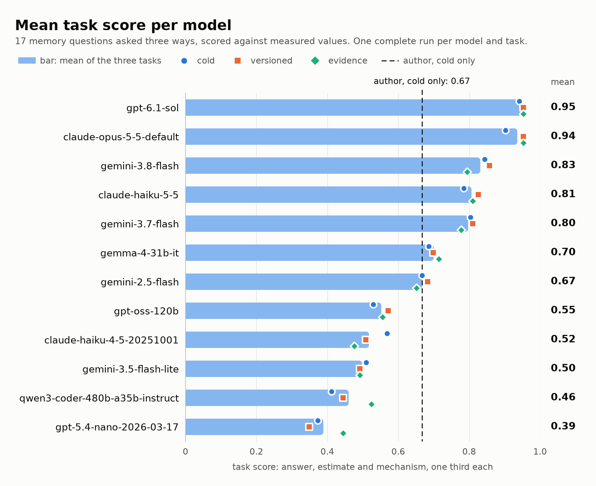
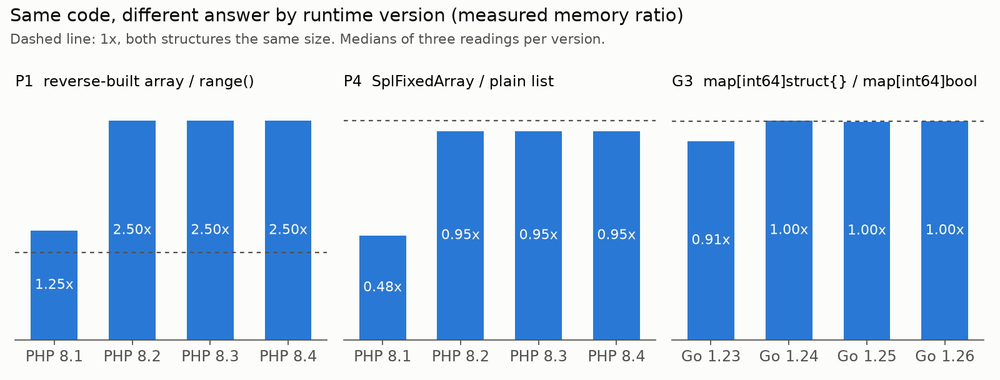
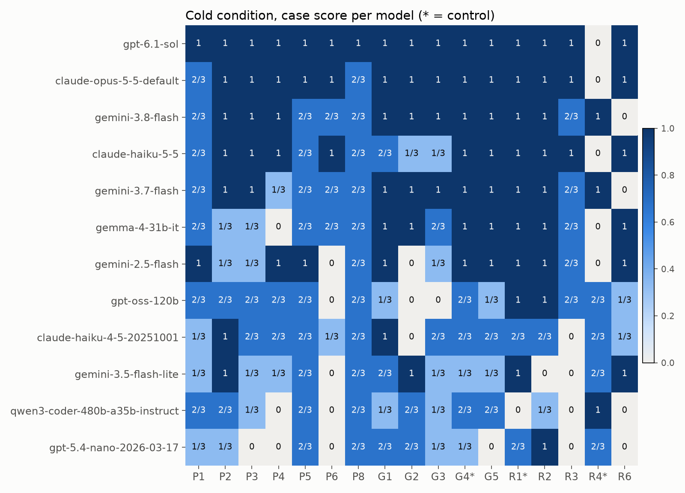

# MemoryTrap Bench

Seventeen memory questions about PHP arrays, Go maps and goroutine stacks, asked
to language models and scored against numbers measured on pinned runtime
versions.



The benchmark and its leaderboard are on Kaggle:
[MemoryTrap Bench: PHP arrays, Go maps, goroutines](https://www.kaggle.com/benchmarks/nb9300/memorytrap-bench-php-arrays-go-maps/leaderboard).

Twelve models have a complete run on the three Kaggle tasks
([memorytrap-cold](https://www.kaggle.com/benchmarks/tasks/nb9300/memorytrap-cold),
[memorytrap-versioned](https://www.kaggle.com/benchmarks/tasks/nb9300/memorytrap-versioned),
[memorytrap-evidence](https://www.kaggle.com/benchmarks/tasks/nb9300/memorytrap-evidence)).
`gpt-6.1-sol` scores 0.95 and `claude-opus-5-5-default` 0.94 on average, and
both lose the same control in all three tasks: they say a new idle goroutine
starts at 16 KB once the runtime has seen big stacks, where the harness
measured 2.0 KB. Every table is in [results/REPORT.md](results/REPORT.md).

Guess first, then see the measurement:
[nazboyko.github.io/memory-trap-bench](https://nazboyko.github.io/memory-trap-bench/).

PHP and Go developers carry rules of thumb about memory, and the runtimes
changed under several of them. On PHP 8.1 an array of one million integers
built in reverse order takes 1.25 times the memory of the same numbers from
`range()`; on PHP 8.3 it takes 2.50 times, because packed arrays stopped
storing keys in PHP 8.2. The benchmark asks whether a model knows the rule,
the runtime, or the version.



## The cases

The harness measured every answer below. The rule of thumb is the option a
developer would pick from memory. Three cases are controls, where the
rule holds, so a model that bets against every rule loses points there.

| Case | Question in one line | Rule of thumb | Measured |
|---|---|---|---|
| P1 | `range(1, 1e6)` vs the same keys inserted from 1e6 down to 1 | About the same | PHP 8.1: 25% more. PHP 8.3: 2.5x as much |
| P2 | `unset()` every second element of a 1e6 list | Drops by about half | PHP 8.1 and 8.3: stays the same |
| P3 | 100k objects with 3 declared properties vs 100k 3-key arrays | Arrays take half as much | PHP 8.1 and 8.3: arrays take about 3 times as much |
| P4 | `SplFixedArray(1e6)` vs a plain list of 1e6 ints | SplFixedArray takes half as much | PHP 8.1: half as much. PHP 8.3: about the same |
| P5 | `$b = $a;` then `$b[] = 0;` on a 1e6 list | The assignment copies | PHP 8.3: the assignment adds nothing; the append copies |
| P6 | int keys vs numeric string keys, 1e6 each | String keys take twice as much | PHP 8.3: about the same |
| P8 | 1e6 two-element arrays `[$i, $i]`, memory per pair | About 32 bytes per pair | PHP 8.1: about 410 bytes. PHP 8.3: about 230 bytes |
| G1 | `map[int64]int64` with 1e6 entries, heap per entry | About 16 bytes per entry | Go 1.23 and 1.24: about 40 bytes per entry |
| G2 | delete every key vs `clear(m)`, then GC | Both give the memory back | Go 1.23 and 1.24: both keep the full size |
| G3 | `map[int64]struct{}` vs `map[int64]bool` | The set is half the size | Go 1.23: about 10% smaller. Go 1.24: the same |
| G4 (control) | `make(map, 1e6)` vs grow from empty, total bytes allocated | Growing allocates twice as much | Go 1.24: twice as much |
| G5 | `map[int64][256]byte` vs `map[int64]*[256]byte` | The value map is 3 times larger | Go 1.24: about the same |
| R1 (control) | 100k goroutines blocked on a channel, stack each | About 2 KB | Go 1.24: about 2 KB |
| R2 | 100k goroutines holding an 8 KB local array, stack each | About 10 KB | Go 1.24: about 16 KB |
| R3 | stack left after `deep(1000)` with 1 KB frames returns, two GCs later | Back to about 2 KB | Go 1.24: a quarter of the peak |
| R4 (control) | new idle goroutines started after a GC saw 16 KB stacks | About 2 KB | Go 1.24: about 2 KB |
| R6 | the same idle goroutines, started after the 16 KB goroutines exited | About 2 KB | Go 1.24: about 16 KB |

The exact code, options and mechanisms are in [cases/cases.json](cases/cases.json);
the measured values for every version are in [cases/truth.json](cases/truth.json).

## How it works

**Harness.** [measure/php/run.php](measure/php/run.php) builds each structure
in its own function and reads `memory_get_usage()` after
`gc_collect_cycles()`, while the structure is still referenced.
[measure/go/main.go](measure/go/main.go) runs every case in its own child
process, turns the collector off while it builds, calls `runtime.GC()` and
reads `runtime.MemStats` (HeapInuse for maps, StackInuse for goroutine stacks,
TotalAlloc for G4). Deltas are signed, and every structure stays alive until
after its reading.

**Versions.** A GitHub Actions matrix ([measure.yml](.github/workflows/measure.yml))
runs the harness three times on PHP 8.1, 8.2, 8.3 and 8.4 (CLI, NTS, opcache
off) and on Go 1.23, 1.24, 1.25 and 1.26 (linux/amd64). The readings are in
[results/measurements/](results/measurements/).

**Truth.** `python -m memtrap.truth` takes the median of the three readings
and lets each case's decision rule in `cases.json` pick the answer from the
numbers. When the versions a case names disagree, the correct answer without
a version is "it depends on the version".

**Three conditions, three Kaggle tasks.** Each case is asked three times:
with the code only (cold), with the code and the runtime version
(versioned), and with the version plus one measured fact from another case of
the same family (evidence). Where the measured answer changes between
versions, the versioned and evidence tasks ask once per version. That makes
17, 21 and 21 prompts.

**Scoring.** No LLM judge. The reply is JSON with an answer letter, an
estimate in MB or KB, a mechanism letter, a confidence and a short reasoning.
Each case scores one third for the answer, one third for an estimate within
0.67x to 1.5x of the measured value, and one third for the mechanism. A reply
that cannot be parsed after one repair turn scores zero and is counted as a
parse failure. The task score is the mean over its prompts.

## Reproduce

Measure on whatever PHP and Go you have installed (three readings each into
`results/measurements/local-*.json`):

```bash
sh measure/run.sh
```

Then merge, check and test (needs [uv](https://docs.astral.sh/uv/)):

```bash
uv run python -m memtrap.truth
uv run python -m memtrap.validate
uv run pytest
```

`memtrap.truth` prefers the Actions readings (`gha-*.json`) for a version that
has them. To rerun the full version matrix, fork the repository and run
`gh workflow run measure.yml`, then `gh run download <run id> -D <dir>` and
copy the JSON files into `results/measurements/`.

Kaggle tasks:

```bash
uv run python -m memtrap.build_tasks
uv run python -m memtrap.stub_run
sh kaggle/run.sh all
uv run python -m memtrap.analyze
uv run python -m memtrap.site
uv run python -m memtrap.images
```

`build_tasks` writes the three task files under [kaggle/](kaggle/) from the
catalog and the truth. `stub_run` runs them offline against three fake models
(always right, always the rule of thumb, never JSON) as a check of parsing and
scoring. `kaggle/run.sh` pushes the tasks, runs the model lineup in batches,
and downloads the run files into `results/kaggle/`. `analyze` rescores every
raw reply and writes [results/REPORT.md](results/REPORT.md). A push creates a
new task version, and Kaggle then lists and downloads only the runs of that
version, so download before you push again. `site` writes the guess-first
page and `images` the three pictures under [docs/img/](docs/img/), both from
the same run files.

## Models and results

Twelve models from Kaggle's model list, on three axes: a small and a flagship
model per vendor, a newer against an older generation of the same vendor, and
open weights: `gemini-3.5-flash-lite`, `gemini-3.8-flash`,
`gemini-3.1-pro-preview`, `gemini-2.5-flash`, `claude-haiku-5-5`,
`claude-opus-5-5-default`, `claude-haiku-4-5-20251001`,
`gpt-5.4-nano-2026-03-17`, `gpt-6.1-sol`, `gpt-oss-120b`, `gemma-4-31b-it`,
`qwen3-coder-480b-a35b-instruct`. Kaggle also runs every task once on
`gemini-3.7-flash` when the task is created; those runs are kept.

Task score per condition, one complete run per model and task, from
[results/REPORT.md](results/REPORT.md) section 2:

| model | cold | versioned | evidence | mean |
|---|---|---|---|---|
| `gpt-6.1-sol` | 0.94 | 0.95 | 0.95 | 0.95 |
| `claude-opus-5-5-default` | 0.90 | 0.95 | 0.95 | 0.94 |
| `gemini-3.8-flash` | 0.84 | 0.86 | 0.79 | 0.83 |
| `claude-haiku-5-5` | 0.78 | 0.83 | 0.81 | 0.81 |
| `gemini-3.7-flash` | 0.80 | 0.81 | 0.78 | 0.80 |
| `gemma-4-31b-it` | 0.69 | 0.70 | 0.71 | 0.70 |
| `gemini-2.5-flash` | 0.67 | 0.68 | 0.65 | 0.67 |
| author, cold only | 0.67 | | | |
| `gpt-oss-120b` | 0.53 | 0.57 | 0.56 | 0.55 |
| `claude-haiku-4-5-20251001` | 0.57 | 0.51 | 0.48 | 0.52 |
| `gemini-3.5-flash-lite` | 0.51 | 0.49 | 0.49 | 0.50 |
| `qwen3-coder-480b-a35b-instruct` | 0.41 | 0.44 | 0.52 | 0.46 |
| `gpt-5.4-nano-2026-03-17` | 0.37 | 0.35 | 0.44 | 0.39 |

`gemini-3.1-pro-preview` has no complete run yet and is not ranked; its
partial replies are in [results/kaggle/](results/kaggle/). The row without a
slug is my own cold score, answered before I saw any measurement: 10 of 17
answers, 14 of 17 mechanisms and 10 of 17 estimates
([results/human_baseline.json](results/human_baseline.json)). It is the dashed
line in the chart at the top.



More from the report:

- **R4 and R6.** The same idle goroutines measure 2.0 KB each while the
  big-stack goroutines are alive (R4, a control) and 16.0 KB after they have
  exited (R6). Over 36 runs a model got both right in 2 (section 9).
- **Version sensitivity.** Four cases change their measured answer with the
  version. Two models followed all four; six followed none (section 6).
- **"It depends on the version"** was picked in 13 of 48 cold replies where it
  is the measured answer (section 6).
- **Confidence.** Seven of the twelve models put a confidence of 80 or more
  on every wrong answer they gave (section 5).
- **The same question twice.** Over 501 pairs of replies to the same prompt,
  the answer matched in 82% (section 12).

### The quota

Kaggle's model proxy reserves the worst-case cost of every call (the model's
maximum output at its output price) against a daily quota, 10 USD for this
account ([results/kaggle/quota.json](results/kaggle/quota.json)). The first
pass started twelve models at once and 160 questions were refused; those run
files are kept under `results/kaggle/*/memorytrap-*/1/`. Task version 2 sends
`max_tokens=32768` with every call and waits out a refused reservation, and
`kaggle/run.sh` runs four models at a time. `sh kaggle/run.sh quota` prints
the quota, which CLI 2.2.4 does not.

## Limits

- Seventeen cases, one scored run per model and condition. Most models also
  have replies from the partial first pass; the report compares the two.
- `gemini-3.1-pro-preview` has no complete run.
- One machine type per version (GitHub's ubuntu-24.04 runner). Other builds,
  allocators and architectures can give other numbers; the local Go 1.26
  readings on darwin/arm64 are kept as a cross-check.
- The `kaggle-benchmarks` library sends no temperature through the Kaggle
  model proxy (`support_temperature` is False there), so a rerun can differ.
- Every call of task version 2 carries `max_tokens=32768`. The longest reply
  in any run file used 22,329 output tokens.
- The estimate tolerance (0.67x to 1.5x) is wide on purpose; the answer and
  the mechanism carry two thirds of the score.
- The human baseline is one developer.

## Credits

- [Kaggle Benchmarks](https://www.kaggle.com/benchmarks) and the
  `kaggle-benchmarks` Python library run the tasks and the models.
- [shivammathur/setup-php](https://github.com/shivammathur/setup-php) and
  [actions/setup-go](https://github.com/actions/setup-go) provide the runtime
  versions in CI.
- The PHP packed-array change measured between 8.1 and 8.2 is
  [php-src pull request 7491](https://github.com/php/php-src/pull/7491) by
  Dmitry Stogov, "Use more compact representation for packed arrays", which
  stores an array of zvals without keys.
- [Go 1.24 release notes](https://go.dev/doc/go1.24#runtime) (the map
  implementation based on Swiss Tables) and
  [Go 1.19 release notes](https://go.dev/doc/go1.19#runtime) (initial
  goroutine stacks sized from historic average stack usage).
- The Go runtime source, `runtime/proc.go`:
  [`newproc1`](https://go.dev/src/runtime/proc.go#L5352) gives a new goroutine
  the minimum stack (`malg(stackMin)`), and
  [`gfget`](https://go.dev/src/runtime/proc.go#L5558) gives a reused descriptor
  the adaptive size (`startingStackSize`), which is what R4 and R6 measure. The
  links show the current release, Go 1.27; Go 1.23 to 1.26 have the same two
  lines.

## Contest

Built for the DEV x Kaggle Benchmarking Challenge (entries from September 23
to October 11, 2026) by Nazar Boyko ([nazboyko](https://github.com/nazboyko)).

## License

MIT, see [LICENSE](LICENSE).
