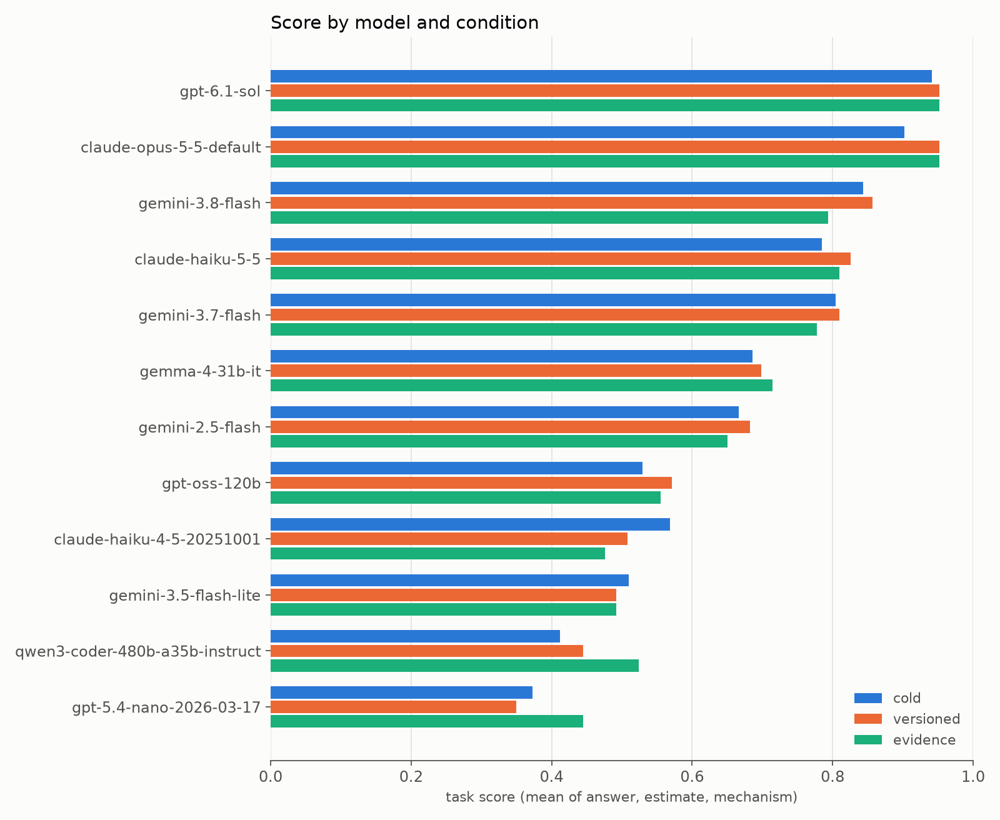
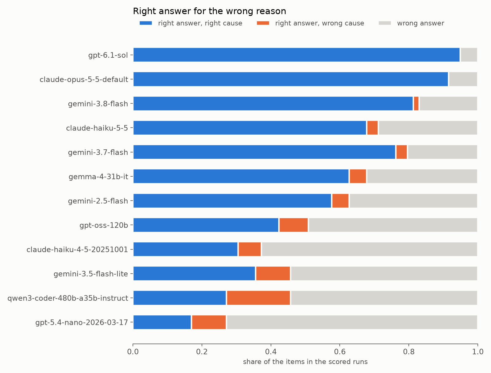
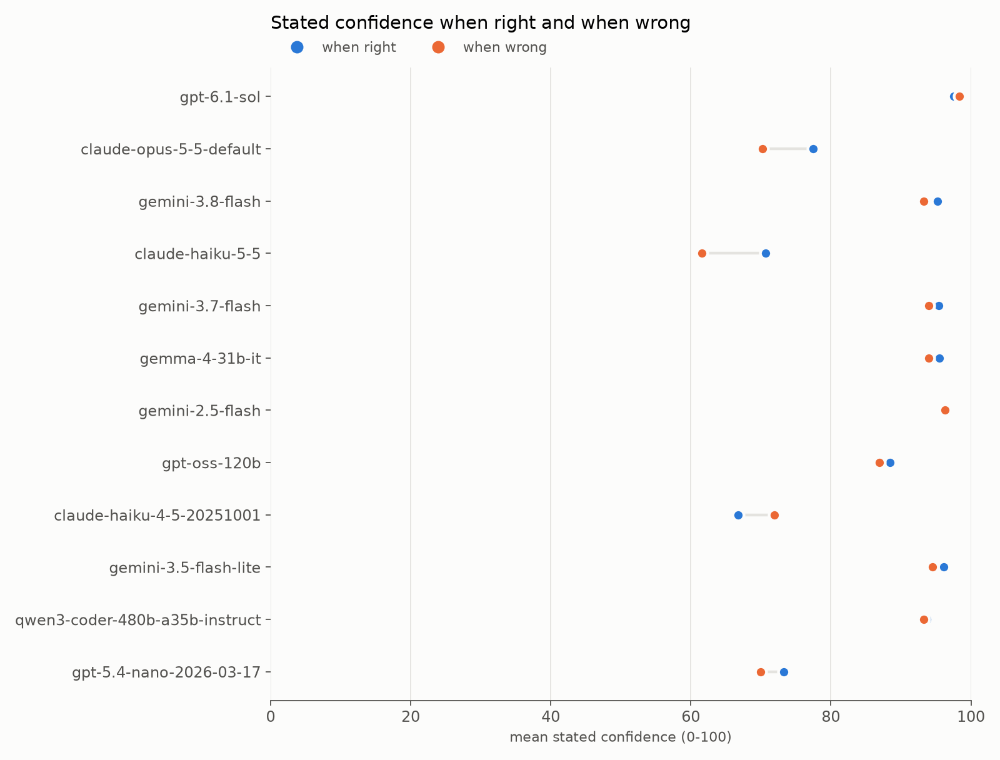

# MemoryTrap Bench: results

Generated by `uv run python -m memtrap.analyze` from `cases/truth.json` and the run files under `results/kaggle/`. Sizes are binary (1 MB = 1,048,576 bytes). Every model reply is parsed and scored again from its raw text.

## 1. What the harness measured

Readings per version: 3 (median used). Source: gha (gha = GitHub Actions). Platforms: Linux, cli, NTS, opcache off; linux/amd64. Versions measured: Go 1.23, Go 1.24, Go 1.25, Go 1.26, PHP 8.1, PHP 8.2, PHP 8.3, PHP 8.4. Metrics: HeapInuse, StackInuse, TotalAlloc, memory_get_usage, as deltas around the measured structure; Go readings follow `runtime.GC()`, PHP readings follow `gc_collect_cycles()`. Full values per version are in `cases/truth.json`. The decision quantities are the ratios each case's rules in `cases/cases.json` use (for example r = b / a).

| case | what is measured | measured answer per version asked (decision quantities; estimate target) | cold answer | rule of thumb |
|---|---|---|---|---|
| P1 | Packed list versus the same integers inserted in reverse | PHP 8.1: A. $b takes about 25% more than $a (r = 1.25; 40.0 MB) PHP 8.3: B. $b takes about 2.5x as much (r = 2.50; 40.0 MB) | D. It depends on the PHP version | C. About the same |
| P2 | Unsetting every second element of a packed list | PHP 8.1: A. It stays about the same (r = 1.00; 32.0 MB) PHP 8.3: A. It stays about the same (r = 1.00; 16.0 MB) | A. It stays about the same | B. It drops by about half |
| P3 | Objects with declared properties versus arrays with the same keys | PHP 8.1: B. $arrays takes about 3 times as much (r = 2.82; 39.86 MB) PHP 8.3: B. $arrays takes about 3 times as much (r = 3.12; 37.86 MB) | B. $arrays takes about 3 times as much | D. $arrays takes about half as much |
| P4 | SplFixedArray versus a plain list of integers | PHP 8.1: A. $fixed takes about half as much (r = 0.48; 15.26 MB) PHP 8.3: B. About the same (r = 0.95; 15.26 MB) | D. It depends on the PHP version | A. $fixed takes about half as much |
| P5 | Assignment of a big array, then one append | PHP 8.3: C. Line 2 adds almost nothing; line 3 adds a full copy of $a (r2 = 0.00, r3 = 1.00; 16.0 MB) | C. Line 2 adds almost nothing; line 3 adds a full copy of $a | A. Line 2 adds a full copy of $a; line 3 adds almost nothing |
| P6 | Integer keys versus numeric string keys | PHP 8.3: A. About the same (r = 1.00; 16.0 MB) | A. About the same | C. $strings takes about twice as much |
| P8 | One million two-element arrays | PHP 8.1: C. About 410 bytes for every pair (q = 409.56; 390.59 MB) PHP 8.3: A. About 230 bytes for every pair (q = 232.78; 222.0 MB) | D. It depends on the PHP version | B. About 32 bytes for every pair |
| G1 | Heap held by a map of one million int64 pairs | Go 1.23: C. About 40 bytes per entry (q = 40.17; 38.3 MB) Go 1.24: C. About 40 bytes per entry (q = 38.13; 36.36 MB) | C. About 40 bytes per entry | B. About 16 bytes per entry |
| G2 | An emptied map: delete every key versus clear() | Go 1.23: A. Both keep about the full size (rd = 1.00, rc = 1.00; 38.3 MB) Go 1.24: A. Both keep about the full size (rd = 1.00, rc = 1.00; 36.38 MB) | A. Both keep about the full size | C. Both give the memory back |
| G3 | map[int64]struct{} versus map[int64]bool | Go 1.23: A. set is about 10% smaller (r = 0.91; 21.3 MB) Go 1.24: C. About the same (r = 1.00; 36.37 MB) | D. It depends on the Go version | B. set is about half the size of flags |
| G4 (control) | Preallocated map versus a map grown from empty | Go 1.24: A. grown allocates about twice as much (r = 1.99; 71.88 MB) | A. grown allocates about twice as much | A. grown allocates about twice as much |
| G5 | Map of 256-byte arrays versus map of pointers to them | Go 1.24: B. About the same (r = 1.00; 26.75 MB) | B. About the same | D. byValue is about 3 times larger |
| R1 (control) | Stack of an idle goroutine | Go 1.24: C. About 2 KB (q = 2048.00; 2.0 KB) | C. About 2 KB | C. About 2 KB |
| R2 | Goroutines that hold an 8 KB local array | Go 1.24: C. About 16 KB (q = 16384.33; 16.0 KB) | C. About 16 KB | D. About 10 KB |
| R3 | Stack after a deep recursion returns | Go 1.24: B. About a quarter of that size (kb = 512.32, r = 0.25; 512.32 KB) | B. About a quarter of that size | A. Back to the starting size of about 2 KB |
| R4 (control) | New goroutines started while big-stack goroutines are alive | Go 1.24: B. About 2 KB (q = 2047.34; 2.0 KB) | B. About 2 KB | B. About 2 KB |
| R6 | Idle goroutines started after big-stack goroutines exited | Go 1.24: A. About 16 KB (q = 16387.28; 16.0 KB) | A. About 16 KB | C. About 2 KB |

Prompts per task: cold 17, versioned 21, evidence 21. Cases whose answer differs between the two versions asked are asked once per version in the versioned and evidence tasks.

## 2. Leaderboard

Task score = mean over items of (answer + estimate + mechanism) / 3. A model is scored on a condition only from a run in which every item got a reply. The mean needs all three conditions; models without it are listed below the ranked ones.

| model | cold | versioned | evidence | mean | parse failures |
|---|---|---|---|---|---|
| `gpt-6.1-sol` | 0.94 | 0.95 | 0.95 | 0.95 | 0 |
| `claude-opus-5-5-default` | 0.90 | 0.95 | 0.95 | 0.94 | 0 |
| `gemini-3.8-flash` | 0.84 | 0.86 | 0.79 | 0.83 | 0 |
| `claude-haiku-5-5` | 0.78 | 0.83 | 0.81 | 0.81 | 0 |
| `gemini-3.7-flash` | 0.80 | 0.81 | 0.78 | 0.80 | 0 |
| `gemma-4-31b-it` | 0.69 | 0.70 | 0.71 | 0.70 | 0 |
| `gemini-2.5-flash` | 0.67 | 0.68 | 0.65 | 0.67 | 0 |
| `gpt-oss-120b` | 0.53 | 0.57 | 0.56 | 0.55 | 0 |
| `claude-haiku-4-5-20251001` | 0.57 | 0.51 | 0.48 | 0.52 | 0 |
| `gemini-3.5-flash-lite` | 0.51 | 0.49 | 0.49 | 0.50 | 0 |
| `qwen3-coder-480b-a35b-instruct` | 0.41 | 0.44 | 0.52 | 0.46 | 0 |
| `gpt-5.4-nano-2026-03-17` | 0.37 | 0.35 | 0.44 | 0.39 | 0 |

Run files of the three tasks: 71. Scored: 36 complete runs (task version 2), one per model and condition. Items whose prompt differs from the current task (stale, never scored): 0. Items whose stored score differs from the rescore: 0.

### Runs without a reply for every item

160 items in 21 of the 71 run files got no reply; 160 of them were refused by Kaggle's model proxy with "The max estimated cost of operation exceeds your available quota". The proxy reserves the worst-case cost of every call (the model's maximum output at its output price) against the daily quota while the call runs, so many models at once are refused long before the money is spent. Those runs are kept in the repository; their replies are compared with the scored runs in section 12 and used nowhere else.

Model and condition pairs with no complete run yet. They are not ranked and not used in the sections below; a score over the items that happened to get through would not be comparable.

| model | condition | task version | items answered | refused on quota | cost, USD | longest reply |
|---|---|---|---|---|---|---|
| `gemini-3.1-pro-preview` | cold | 1 | 13 of 17 | 4 | 0.886 | 14,300 |
| `gemini-3.1-pro-preview` | versioned | 1 | 8 of 21 | 13 | 0.860 | 22,064 |
| `gemini-3.1-pro-preview` | evidence | 1 | 1 of 21 | 20 | 0.102 | 8,349 |

### Output and cost of the scored runs

Output tokens include the model's reasoning tokens. Cost is what the proxy charged, from the run files.

| model | items | output tokens per item | longest reply | cost, USD |
|---|---|---|---|---|
| `gpt-6.1-sol` | 59 | 467 | 1,243 | 0.330 |
| `claude-opus-5-5-default` | 59 | 724 | 2,041 | 1.014 |
| `gemini-3.8-flash` | 59 | 2,235 | 7,533 | 0.517 |
| `claude-haiku-5-5` | 59 | 953 | 1,351 | 0.032 |
| `gemini-3.7-flash` | 59 | 2,610 | 22,329 | 0.600 |
| `gemma-4-31b-it` | 59 | 3,538 | 10,510 | 0.130 |
| `gemini-2.5-flash` | 59 | 5,445 | 13,496 | 0.812 |
| `gpt-oss-120b` | 59 | 838 | 1,864 | 0.021 |
| `claude-haiku-4-5-20251001` | 59 | 120 | 344 | 0.066 |
| `gemini-3.5-flash-lite` | 59 | 121 | 494 | 0.027 |
| `qwen3-coder-480b-a35b-instruct` | 59 | 83 | 116 | 0.012 |
| `gpt-5.4-nano-2026-03-17` | 59 | 93 | 117 | 0.012 |

The run files of the three tasks together cost 7.84 USD. The longest single reply in any of them used 22,329 output tokens; replies that reached the 32,768-token cap of task version 2: 0.

## 3. Per case, cold condition

## 4. Right answer, wrong mechanism

All items of the conditions a model completed. Folklore mechanism counts only non-control items.

| model | items | right answers | right answer, wrong mechanism | share of right answers | folklore mechanism chosen |
|---|---|---|---|---|---|
| `gpt-6.1-sol` | 59 | 56 | 0 | 0% | 0 |
| `claude-opus-5-5-default` | 59 | 54 | 0 | 0% | 0 |
| `gemini-3.8-flash` | 59 | 49 | 1 | 2% | 5 |
| `claude-haiku-5-5` | 59 | 42 | 2 | 5% | 3 |
| `gemini-3.7-flash` | 59 | 47 | 2 | 4% | 6 |
| `gemma-4-31b-it` | 59 | 40 | 3 | 8% | 1 |
| `gemini-2.5-flash` | 59 | 37 | 3 | 8% | 10 |
| `gpt-oss-120b` | 59 | 30 | 5 | 17% | 10 |
| `claude-haiku-4-5-20251001` | 59 | 22 | 4 | 18% | 3 |
| `gemini-3.5-flash-lite` | 59 | 27 | 6 | 22% | 9 |
| `qwen3-coder-480b-a35b-instruct` | 59 | 27 | 11 | 41% | 18 |
| `gpt-5.4-nano-2026-03-17` | 59 | 16 | 6 | 38% | 18 |

## 5. Confidence

Confidently wrong = wrong answer with stated confidence of 80 or more.

| model | mean confidence when right | when wrong | calibration gap | wrong answers | confidently wrong |
|---|---|---|---|---|---|
| `gpt-6.1-sol` | 97.5 | 98.3 | -0.8 | 3 | 3 |
| `claude-opus-5-5-default` | 77.5 | 70.2 | 7.3 | 5 | 1 |
| `gemini-3.8-flash` | 95.3 | 93.3 | 2.0 | 10 | 10 |
| `claude-haiku-5-5` | 70.7 | 61.6 | 9.1 | 17 | 0 |
| `gemini-3.7-flash` | 95.4 | 94.0 | 1.4 | 12 | 12 |
| `gemma-4-31b-it` | 95.5 | 93.9 | 1.6 | 19 | 19 |
| `gemini-2.5-flash` | 96.2 | 96.3 | -0.1 | 22 | 22 |
| `gpt-oss-120b` | 88.4 | 86.9 | 1.5 | 29 | 26 |
| `claude-haiku-4-5-20251001` | 66.7 | 71.9 | -5.2 | 37 | 4 |
| `gemini-3.5-flash-lite` | 96.1 | 94.5 | 1.6 | 32 | 32 |
| `qwen3-coder-480b-a35b-instruct` | 93.7 | 93.3 | 0.4 | 32 | 32 |
| `gpt-5.4-nano-2026-03-17` | 73.3 | 70.0 | 3.3 | 43 | 6 |

Models that put 80 or more on every wrong answer they gave: 7 of 12 (`gpt-6.1-sol`, `gemini-3.8-flash`, `gemini-3.7-flash`, `gemma-4-31b-it`, `gemini-2.5-flash`, `gemini-3.5-flash-lite`, `qwen3-coder-480b-a35b-instruct`).

## 6. Version sensitivity

Versioned condition, the cases whose measured answer differs between the two versions asked. Tracks = both version answers correct.

| case | model | older version: answer (measured) | newer version: answer (measured) | changed | tracks |
|---|---|---|---|---|---|
| P1 | `gpt-6.1-sol` | PHP 8.1: A (A) | PHP 8.3: B (B) | yes | yes |
| P1 | `claude-opus-5-5-default` | PHP 8.1: A (A) | PHP 8.3: B (B) | yes | yes |
| P1 | `gemini-3.8-flash` | PHP 8.1: A (A) | PHP 8.3: B (B) | yes | yes |
| P1 | `claude-haiku-5-5` | PHP 8.1: A (A) | PHP 8.3: B (B) | yes | yes |
| P1 | `gemini-3.7-flash` | PHP 8.1: C (A) | PHP 8.3: B (B) | yes | no |
| P1 | `gemma-4-31b-it` | PHP 8.1: B (A) | PHP 8.3: B (B) | no | no |
| P1 | `gemini-2.5-flash` | PHP 8.1: B (A) | PHP 8.3: B (B) | no | no |
| P1 | `gpt-oss-120b` | PHP 8.1: B (A) | PHP 8.3: B (B) | no | no |
| P1 | `claude-haiku-4-5-20251001` | PHP 8.1: B (A) | PHP 8.3: B (B) | no | no |
| P1 | `gemini-3.5-flash-lite` | PHP 8.1: B (A) | PHP 8.3: B (B) | no | no |
| P1 | `qwen3-coder-480b-a35b-instruct` | PHP 8.1: B (A) | PHP 8.3: B (B) | no | no |
| P1 | `gpt-5.4-nano-2026-03-17` | PHP 8.1: B (A) | PHP 8.3: B (B) | no | no |
| P4 | `gpt-6.1-sol` | PHP 8.1: A (A) | PHP 8.3: B (B) | yes | yes |
| P4 | `claude-opus-5-5-default` | PHP 8.1: A (A) | PHP 8.3: B (B) | yes | yes |
| P4 | `gemini-3.8-flash` | PHP 8.1: A (A) | PHP 8.3: B (B) | yes | yes |
| P4 | `claude-haiku-5-5` | PHP 8.1: A (A) | PHP 8.3: B (B) | yes | yes |
| P4 | `gemini-3.7-flash` | PHP 8.1: A (A) | PHP 8.3: B (B) | yes | yes |
| P4 | `gemma-4-31b-it` | PHP 8.1: B (A) | PHP 8.3: B (B) | no | no |
| P4 | `gemini-2.5-flash` | PHP 8.1: C (A) | PHP 8.3: B (B) | yes | no |
| P4 | `gpt-oss-120b` | PHP 8.1: A (A) | PHP 8.3: B (B) | yes | yes |
| P4 | `claude-haiku-4-5-20251001` | PHP 8.1: A (A) | PHP 8.3: A (B) | no | no |
| P4 | `gemini-3.5-flash-lite` | PHP 8.1: A (A) | PHP 8.3: A (B) | no | no |
| P4 | `qwen3-coder-480b-a35b-instruct` | PHP 8.1: A (A) | PHP 8.3: A (B) | no | no |
| P4 | `gpt-5.4-nano-2026-03-17` | PHP 8.1: B (A) | PHP 8.3: B (B) | no | no |
| P8 | `gpt-6.1-sol` | PHP 8.1: C (C) | PHP 8.3: A (A) | yes | yes |
| P8 | `claude-opus-5-5-default` | PHP 8.1: C (C) | PHP 8.3: A (A) | yes | yes |
| P8 | `gemini-3.8-flash` | PHP 8.1: C (C) | PHP 8.3: A (A) | yes | yes |
| P8 | `claude-haiku-5-5` | PHP 8.1: C (C) | PHP 8.3: A (A) | yes | yes |
| P8 | `gemini-3.7-flash` | PHP 8.1: C (C) | PHP 8.3: A (A) | yes | yes |
| P8 | `gemma-4-31b-it` | PHP 8.1: C (C) | PHP 8.3: C (A) | no | no |
| P8 | `gemini-2.5-flash` | PHP 8.1: A (C) | PHP 8.3: A (A) | no | no |
| P8 | `gpt-oss-120b` | PHP 8.1: A (C) | PHP 8.3: A (A) | no | no |
| P8 | `claude-haiku-4-5-20251001` | PHP 8.1: C (C) | PHP 8.3: C (A) | no | no |
| P8 | `gemini-3.5-flash-lite` | PHP 8.1: C (C) | PHP 8.3: C (A) | no | no |
| P8 | `qwen3-coder-480b-a35b-instruct` | PHP 8.1: A (C) | PHP 8.3: A (A) | no | no |
| P8 | `gpt-5.4-nano-2026-03-17` | PHP 8.1: C (C) | PHP 8.3: C (A) | no | no |
| G3 | `gpt-6.1-sol` | Go 1.23: A (A) | Go 1.24: C (C) | yes | yes |
| G3 | `claude-opus-5-5-default` | Go 1.23: A (A) | Go 1.24: C (C) | yes | yes |
| G3 | `gemini-3.8-flash` | Go 1.23: A (A) | Go 1.24: B (C) | yes | no |
| G3 | `claude-haiku-5-5` | Go 1.23: A (A) | Go 1.24: B (C) | yes | no |
| G3 | `gemini-3.7-flash` | Go 1.23: A (A) | Go 1.24: B (C) | yes | no |
| G3 | `gemma-4-31b-it` | Go 1.23: C (A) | Go 1.24: B (C) | yes | no |
| G3 | `gemini-2.5-flash` | Go 1.23: A (A) | Go 1.24: A (C) | no | no |
| G3 | `gpt-oss-120b` | Go 1.23: A (A) | Go 1.24: A (C) | no | no |
| G3 | `claude-haiku-4-5-20251001` | Go 1.23: B (A) | Go 1.24: B (C) | no | no |
| G3 | `gemini-3.5-flash-lite` | Go 1.23: B (A) | Go 1.24: B (C) | no | no |
| G3 | `qwen3-coder-480b-a35b-instruct` | Go 1.23: A (A) | Go 1.24: A (C) | no | no |
| G3 | `gpt-5.4-nano-2026-03-17` | Go 1.23: B (A) | Go 1.24: B (C) | no | no |

Per model, split cases tracked (of 4): `gpt-6.1-sol` 4, `claude-opus-5-5-default` 4, `gemini-3.8-flash` 3, `claude-haiku-5-5` 3, `gemini-3.7-flash` 2, `gemma-4-31b-it` 0, `gemini-2.5-flash` 0, `gpt-oss-120b` 1, `claude-haiku-4-5-20251001` 0, `gemini-3.5-flash-lite` 0, `qwen3-coder-480b-a35b-instruct` 0, `gpt-5.4-nano-2026-03-17` 0.

Per case, models that tracked it: G3 2 of 12, P1 4 of 12, P4 6 of 12, P8 5 of 12.

Cold condition, the same cases without a version in the prompt, where the measured answer is "it depends on the version". Models that picked it: P1 2 of 12, P4 5 of 12, P8 1 of 12, G3 5 of 12; 13 of 48 replies in all.

## 7. Evidence update

Per case, answer correctness moving from cold (or versioned) to evidence. Net = gained minus lost.

| model | cold to evidence: gained | lost | net | versioned to evidence: gained | lost |
|---|---|---|---|---|---|
| `gpt-6.1-sol` | 0 | 0 | 0 | 0 | 0 |
| `claude-opus-5-5-default` | 2 | 0 | 2 | 0 | 0 |
| `gemini-3.8-flash` | 0 | 2 | -2 | 0 | 3 |
| `claude-haiku-5-5` | 2 | 1 | 1 | 0 | 2 |
| `gemini-3.7-flash` | 0 | 1 | -1 | 0 | 2 |
| `gemma-4-31b-it` | 2 | 2 | 0 | 1 | 1 |
| `gemini-2.5-flash` | 2 | 3 | -1 | 1 | 2 |
| `gpt-oss-120b` | 0 | 1 | -1 | 1 | 1 |
| `claude-haiku-4-5-20251001` | 1 | 2 | -1 | 0 | 0 |
| `gemini-3.5-flash-lite` | 1 | 1 | 0 | 2 | 2 |
| `qwen3-coder-480b-a35b-instruct` | 1 | 0 | 1 | 2 | 1 |
| `gpt-5.4-nano-2026-03-17` | 3 | 1 | 2 | 3 | 1 |

All models, cold to evidence: 14 answers gained, 14 lost. Versioned to evidence: 10 gained, 15 lost.

## 8. Folklore index

How often each case's folklore mechanism and folklore answer were chosen, over every scored run. Controls are never counted.

| case | replies | folklore mechanism | folklore answer (when wrong) |
|---|---|---|---|
| P1 | 60 | 2 | 3 |
| P2 | 36 | 0 | 0 |
| P3 | 36 | 3 | 0 |
| P4 | 60 | 22 | 12 |
| P5 | 36 | 0 | 2 |
| P6 | 36 | 13 | 10 |
| P8 | 60 | 0 | 0 |
| G1 | 36 | 0 | 0 |
| G2 | 36 | 0 | 0 |
| G3 | 60 | 21 | 22 |
| G4 | control | n/a | n/a |
| G5 | 36 | 3 | 4 |
| R1 | control | n/a | n/a |
| R2 | 36 | 1 | 0 |
| R3 | 36 | 5 | 6 |
| R4 | control | n/a | n/a |
| R6 | 36 | 13 | 17 |

## 9. Controls

Controls (G4, R1, R4) are cases where the rule of thumb holds. A model that bets against every rule loses them.

| model | control items asked | control answers wrong | items |
|---|---|---|---|
| `gpt-6.1-sol` | 9 | 3 | R4 (cold), R4@go-1.24 (evidence), R4@go-1.24 (versioned) |
| `claude-opus-5-5-default` | 9 | 3 | R4 (cold), R4@go-1.24 (evidence), R4@go-1.24 (versioned) |
| `gemini-3.8-flash` | 9 | 0 | - |
| `claude-haiku-5-5` | 9 | 4 | R4 (cold), G4@go-1.24 (evidence), R4@go-1.24 (evidence), R4@go-1.24 (versioned) |
| `gemini-3.7-flash` | 9 | 0 | - |
| `gemma-4-31b-it` | 9 | 3 | R4 (cold), R4@go-1.24 (evidence), R4@go-1.24 (versioned) |
| `gemini-2.5-flash` | 9 | 1 | R4 (cold) |
| `gpt-oss-120b` | 9 | 0 | - |
| `claude-haiku-4-5-20251001` | 9 | 3 | R1 (cold), R1@go-1.24 (evidence), R1@go-1.24 (versioned) |
| `gemini-3.5-flash-lite` | 9 | 5 | G4 (cold), G4@go-1.24 (evidence), R1@go-1.24 (evidence), G4@go-1.24 (versioned), R4@go-1.24 (versioned) |
| `qwen3-coder-480b-a35b-instruct` | 9 | 2 | R1 (cold), R1@go-1.24 (evidence) |
| `gpt-5.4-nano-2026-03-17` | 9 | 6 | G4 (cold), R1 (cold), G4@go-1.24 (evidence), G4@go-1.24 (versioned), R1@go-1.24 (versioned), R4@go-1.24 (versioned) |

### R4 and R6: the same goroutines, a different history

Both cases start the same idle goroutines after 100,000 goroutines with 16 KB stacks. In R4 (a control) the big ones are still alive and the harness measured: About 2 KB. In R6 they have exited and it measured: About 16 KB. One row per condition, one scored run per model.

| condition | runs | both right | only R4 right | only R6 right | neither |
|---|---|---|---|---|---|
| cold | 12 | 1 | 6 | 5 | 0 |
| versioned | 12 | 0 | 6 | 5 | 1 |
| evidence | 12 | 1 | 7 | 4 | 0 |

Both right in 2 of 36 runs: `gemini-3.5-flash-lite` (cold), `gemini-3.5-flash-lite` (evidence).

## 10. Human baseline

One developer, the author, answered the cold condition before seeing any measurement. The numbers are in `results/human_baseline.json` as the author reported them, scored with `uv run python -m memtrap.score_human human/answers.json`; the answers file is not in the repository and this report does not read it.

| who | cold score | answers right | mechanisms right | estimates within tolerance | mean confidence when right | when wrong |
|---|---|---|---|---|---|---|
| author | 0.67 | 10 of 17 | 14 of 17 | 10 of 17 | 80.5 | 70.0 |

Cold task scores of the models around it: next above: `gemma-4-31b-it` 0.69; level: `gemini-2.5-flash` 0.67; next below: `claude-haiku-4-5-20251001` 0.57.

On the 4 cases whose measured cold answer is "it depends on the version" (P1, P4, P8, G3), the author answered for one version on 4 and picked the right mechanism on 3.

## 11. Folklore in the models' own words

For each case, the shortest reasoning among replies that chose the folklore mechanism, verbatim.

| case | model | condition | reasoning |
|---|---|---|---|
| P1 | `gemini-3.8-flash` | evidence | "Both use the Zend HashTable structure with table size 2^20 (1,048,576). A packed array uses ~32 MB (buckets), while the hashed table adds arHash (4 MB) totaling ~36 MB. Compared to 15.3 MB for SplFixedArray, both arrays use roughly the same memory (~32 vs ~36 MB)." |
| P3 | `gpt-5.4-nano-2026-03-17` | cold | "In PHP, each $objects element is an object with overhead (zval + object header/handlers/property metadata), while $arrays elements are arrays with overhead too (zval + HashTable + buckets). For 3 fields, these overheads are of the same order, so memory_get_usage() is typically close." |
| P4 | `qwen3-coder-480b-a35b-instruct` | evidence | "SplFixedArray uses contiguous memory without hash tables, unlike PHP arrays which use hash tables. This makes SplFixedArray much more memory-efficient for large sequential data." |
| P6 | `qwen3-coder-480b-a35b-instruct` | versioned | "String keys require separate string objects in memory while integer keys are stored directly. Each string key needs additional memory for the string structure, making string-keyed arrays ~30% larger than integer-keyed ones." |
| G3 | `qwen3-coder-480b-a35b-instruct` | cold | "struct{}{} takes zero bytes, so set only stores keys while flags stores both keys and bool values. Each bool is 1 byte, so flags uses roughly twice the memory for values." |
| G5 | `gpt-5.4-nano-2026-03-17` | versioned | "byValue stores the whole [256]byte value per entry (including remaining bytes), while byPointer stores only an 8-byte pointer in the map but allocates each 256-byte array separately. Total data per entry ends up similar; map/bucket overhead and allocation headers largely balance." |
| R2 | `gpt-5.4-nano-2026-03-17` | versioned | "Each goroutine starts with a small stack (typically 2 KB). When it needs to hold a local [8192]byte, the stack grows, but only to the minimum size that fits the call frames—so the per-goroutine delta is roughly the starting stack plus the added space, not the full 8 KB as a fixed replacement." |
| R3 | `qwen3-coder-480b-a35b-instruct` | evidence | "Go runtime releases unused stack space after function returns and GC cycles. Each goroutine's stack shrinks back to its original size since the large stack was only needed during recursion." |
| R6 | `qwen3-coder-480b-a35b-instruct` | cold | "Each goroutine starts with a small stack (typically 2KB) and grows only if needed. The idle goroutines do minimal work, so they retain the initial small stack size." |

More quotes per case: [quotes.md](quotes.md).

### A control lost, in the models' own words

For each control, the best-ranked models that answered it wrong (at most three), each with its shortest reasoning, verbatim.

| case | model | condition | answer chosen | confidence | reasoning |
|---|---|---|---|---|---|
| G4 | `claude-haiku-5-5` | evidence | B. About the same | 55 | "Swiss-table growth splits 1024-slot tables into new ones, creating about two new tables per split, and each old table becomes garbage. That totals roughly 2,300 tables of about 17 KB, around 40 MB. The pre-sized map allocates roughly its final 36 MB once, so the totals are close." |
| G4 | `gemini-3.5-flash-lite` | evidence | C. grown allocates about 4 times as much | 95 | "Go maps grow exponentially by doubling capacity. Building an unhinted map (`grown`) from empty requires multiple reallocation steps (roughly doubling from small sizes up to $2^{20}$), leaving behind a geometric series of abandoned old hash tables that accumulate in TotalAlloc. In contrast, `pre` allocates the final table size immediately." |
| G4 | `gpt-5.4-nano-2026-03-17` | evidence | B. About the same | 78 | "With pre (hint 1e6) the table is built once, so TotalAlloc is low. With grown (no hint) the map grows through multiple rehash/resizes, leaving prior backing arrays as garbage; TotalAlloc therefore increases. Roughly a few backing tables worth allocation, giving ~2× vs pre." |
| R1 | `claude-haiku-4-5-20251001` | cold | D. About 4 KB | 75 | "Go goroutines start with minimal stack (~2KB) and grow as needed. Blocked goroutines on channel receive don't need additional stack frames, so they retain only their initial allocation. This is much smaller than OS thread stacks." |
| R1 | `gemini-3.5-flash-lite` | evidence | B. About 256 bytes | 95 | "In Go 1.24, new goroutines start with a minimum stack size of 2 KB. Since the spawned goroutines immediately block on the channel without allocating further stack frames, they retain only this initial minimum stack size of 2 KB (approx 2,048 bytes)." |
| R1 | `qwen3-coder-480b-a35b-instruct` | cold | B. About 256 bytes | 95 | "Blocked goroutines release their stacks back to the runtime and only retain a small descriptor with their execution state. This allows Go to handle millions of goroutines efficiently, as only actively running goroutines consume full stack memory." |
| R4 | `gpt-6.1-sol` | cold | A. About 16 KB | 98 | "Since Go 1.19, adaptive stack sizing uses the average stack space scanned during the last GC, adds a stack guard, and rounds up to a power of two. The first batch dominates that average with live frames exceeding 8 KB, so the second batch starts with approximately 16 KB stacks." |
| R4 | `claude-opus-5-5-default` | versioned | A. About 16 KB | 80 | "Since Go 1.19 (adaptivestackstart, on by default), each GC averages scanned stack usage and adds stackGuard. About 8.3 KB used plus a 928-byte guard rounds up to a 16 KB power of two. The 100k live first-batch goroutines dominate that average, so each new idle goroutine starts with 16 KB." |
| R4 | `claude-haiku-5-5` | versioned | A. About 16 KB | 62 | "Since Go 1.19 the runtime sets the starting stack from the average scanned stack use at GC. The 100k 8 KB goroutines use about 8.3 KB each, plus about 928 B stackGuard, which rounds up to a power of two: 16 KB. runtime.GC() runs before the idle batch is spawned, so those goroutines start at 16 KB." |

## 12. The same question twice

Some models have more than one run of the same prompts: the scored run and earlier runs, most of them with quota gaps. Each reply of an earlier run is paired with the scored run's reply to the same prompt. The runs differ in two ways: no temperature is set, and the earlier runs of task version 1 had no `max_tokens` cap.

| model | other runs | reply pairs | same answer | same mechanism | same item score |
|---|---|---|---|---|---|
| `gpt-6.1-sol` | 3 | 19 | 19 (100%) | 19 (100%) | 19 (100%) |
| `claude-opus-5-5-default` | 2 | 25 | 25 (100%) | 25 (100%) | 25 (100%) |
| `gemini-3.8-flash` | 3 | 49 | 44 (90%) | 45 (92%) | 42 (86%) |
| `claude-haiku-5-5` | 3 | 54 | 48 (89%) | 50 (93%) | 45 (83%) |
| `gemini-3.7-flash` | 3 | 59 | 53 (90%) | 53 (90%) | 53 (90%) |
| `gemma-4-31b-it` | 1 | 17 | 15 (88%) | 17 (100%) | 15 (88%) |
| `gemini-2.5-flash` | 3 | 57 | 37 (65%) | 43 (75%) | 36 (63%) |
| `gpt-oss-120b` | 3 | 59 | 43 (73%) | 46 (78%) | 40 (68%) |
| `claude-haiku-4-5-20251001` | 3 | 40 | 36 (90%) | 36 (90%) | 32 (80%) |
| `gemini-3.5-flash-lite` | 3 | 53 | 39 (74%) | 47 (89%) | 40 (75%) |
| `qwen3-coder-480b-a35b-instruct` | 1 | 17 | 17 (100%) | 16 (94%) | 16 (94%) |
| `gpt-5.4-nano-2026-03-17` | 3 | 52 | 34 (65%) | 42 (81%) | 34 (65%) |

All models: 501 reply pairs; same answer in 410 (82%), same mechanism in 439 (88%), same item score in 397 (79%).

## 13. Limits

- 17 cases, 12 models with at least one complete run, one scored run per model and condition.
- kaggle-benchmarks 0.6.1 does not send a temperature through the Kaggle model proxy (`kaggle_benchmarks/kaggle/model_proxy.py` sets `support_temperature` to False), so a rerun can differ; section 12 shows by how much.
- From task version 2 on, the task sends `max_tokens=32768` with every call, which lowers the proxy's quota reservation; a model whose provider rejects the parameter is called again without it, and the run files do not record which. The longest single reply in any run file used 22,329 output tokens.
- Replies that cannot be parsed after one repair turn score zero and are counted as parse failures.
- Measurements are from GitHub Actions runners (linux/amd64, PHP NTS CLI with opcache off); other builds and allocators can differ.
